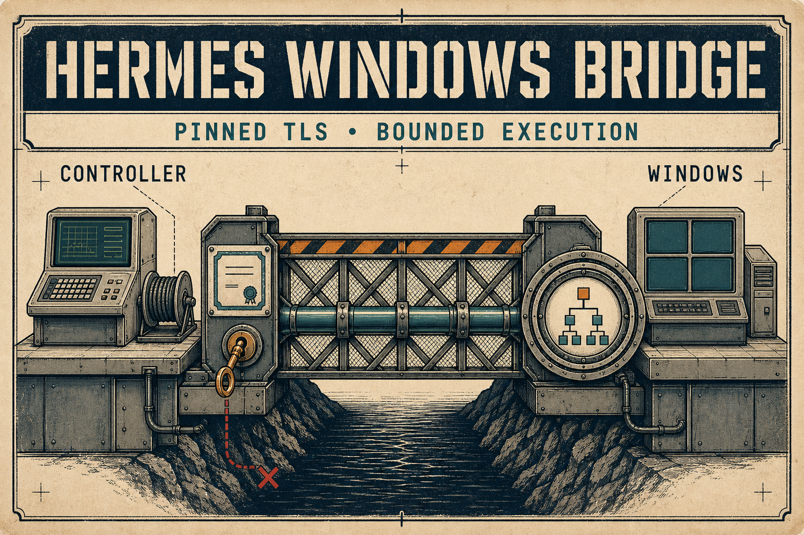
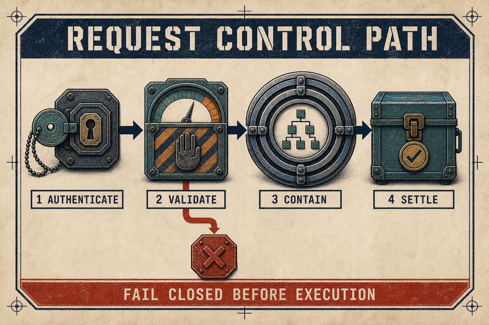

# Hermes Windows Bridge

[](https://github.com/bgrablin/hermes-windows-bridge/actions/workflows/verify.yml)

Hermes Windows Bridge provides authenticated terminal and Hermes execution on a Windows host from a POSIX controller. It uses pinned TLS, bearer authentication, bounded admission, Windows Job Object containment, persistent job state, and a hash-closed release manifest.

The bridge is a privileged operator service. It is not a remote desktop tool or an adversarial shell sandbox.

## Install with Hermes Agent

Give the following brief to a Hermes Agent that can operate the target Windows host. The agent needs terminal and file tools plus access to the public repository. End-to-end verification also requires access to the POSIX controller.

```text
Install Hermes Windows Bridge from https://github.com/bgrablin/hermes-windows-bridge.

Use only this public repository. Do not request or use any earlier private bridge repository, deployment package, certificate, credential, host identity, or recovery material.

Before changing the host, read README.md, docs/operations.md, docs/security-model.md, and release-layout.json. Verify the operating system, Python 3.11 or newer, OpenSSL, Git, and the Hermes CLI. Start from the latest tagged release in a clean clone and record the tag and commit.

Default to a loopback-only listener for the first smoke test. Ask before using a non-loopback listener, changing firewall rules, elevating privileges, replacing an existing installation, or creating a service or scheduled task. This repository does not ship service or scheduled-task automation, so do not invent either without separate approval.

Generate the bearer token, TLS private key, and matching canonical ASCII DNS or IP SAN certificate locally. Use Punycode for an internationalized DNS name. Never print, transmit, or commit the token or private key. Keep them outside the release directory. Build the exact release with tools/build_release.py, run its package-mode check, initialize the Windows private state with Initialize-BridgePrivateState, and apply the documented file protections.

Start the bridge with explicit state, executable, listener, certificate, key, and manifest paths. Verify the manifest again, /health, authenticated /ready and /status, the pinned-TLS controller client, and one harmless command. Restrict any approved non-loopback listener to the intended controller or management network. If the POSIX controller is unavailable, report end-to-end client verification as blocked rather than passed.

Do not report success until the bridge has run and every requested check has returned successfully. Report the installed tag and commit, listener endpoint, release-manifest hash, certificate fingerprint, protected-state locations, tests performed, and exact results. Redact credentials, private keys, tokens, and sensitive command output.
```



## What it does

- Executes allowlisted terminal and Hermes routes through synchronous or persistent jobs.
- Requires TLS and an exact release manifest for every non-loopback listener.
- Pins the server certificate in the controller client.
- Rejects malformed, oversized, unauthenticated, and capacity-exhausted requests before execution.
- Blocks known blind GUI and clipboard automation markers in terminal commands before process creation.
- Contains child processes in a Windows Job Object and certifies descendant cleanup.
- Stores job state and telemetry under private Windows DACLs.
- Returns bounded process output to the authenticated caller; server-generated errors and logs use stable, non-reflective messages.

## Request lifecycle



A request crosses six security decisions before a result is returned: transport, authentication, schema validation, admission, execution containment, and durable settlement. Failure at any boundary returns a stable status and prevents later stages from running.

## Quick start

Requirements:

- Windows 10 or Windows 11 for the bridge service
- Python 3.11 or newer
- Hermes installed on the Windows host when using Hermes routes
- OpenSSL for certificate creation
- A POSIX controller for the included client

Create a certificate whose subject alternative name matches the listener. This example uses a DNS name:

```bash
mkdir -p local
listener="bridge.example"
openssl req -x509 -newkey rsa:3072 -sha256 -nodes \
  -keyout local/bridge-key.pem \
  -out local/bridge-cert.pem \
  -days 397 \
  -subj "/CN=${listener}" \
  -addext "subjectAltName=DNS:${listener}"
```

For a literal IP listener, use an IP SAN instead, such as `subjectAltName=IP:192.0.2.10`. Encoding an IP address as a DNS SAN will fail hostname verification.

Build the exact release package. The private key is supplied to the running service but is never copied into the package.

```bash
python3 tools/build_release.py package \
  --source . \
  --output dist/bridge \
  --certificate local/bridge-cert.pem \
  --listen-address bridge.example \
  --port 8765

python3 tools/build_release.py check \
  --root dist/bridge \
  --manifest dist/bridge/bridge-release.json \
  --mode package
```

On Windows, create the private state directories, store the bearer token and TLS key outside the release directory, then start the server with the matching host, port, certificate, key, and manifest. See [Operations](docs/operations.md) for exact PowerShell commands.

Configure the controller client:

```bash
install -d -m 700 ~/.config/hermes-windows-bridge
install -m 600 /secure/path/bridge-token ~/.config/hermes-windows-bridge/bridge-token
install -m 644 local/bridge-cert.pem ~/.config/hermes-windows-bridge/bridge-cert.pem

client/hermes-windows-bridge \
  --url https://bridge.example:8765 \
  health
```

Run a terminal command or Hermes request:

```bash
client/hermes-windows-bridge --url https://bridge.example:8765 ps Get-Date
client/hermes-windows-bridge --url https://bridge.example:8765 hermes Summarize current bridge status
```

Use an asynchronous job for long-running work:

```bash
client/hermes-windows-bridge --url https://bridge.example:8765 job terminal Get-Process
client/hermes-windows-bridge --url https://bridge.example:8765 get JOB_ID
client/hermes-windows-bridge --url https://bridge.example:8765 cancel JOB_ID
```

## Security boundary

The authenticated caller can request shell execution. Treat the token as a privileged credential and restrict listener reachability with a host firewall, VPN, or equivalent network control.

The literal GUI and clipboard marker guard is bounded defense in depth against accidental blind automation. It does not turn PowerShell or Hermes into an untrusted-code sandbox. See [Security model](docs/security-model.md) for assumptions, controls, and residual risk.

Authenticated terminal and Hermes process stdout and stderr are caller-visible and are not redacted. Do not emit secrets, private paths, or other sensitive values in process output.

## Verification

Run the complete local checks:

```bash
python3 -m pytest -q
python3 scripts/public_surface_check.py
python3 -m ruff check .
```

The test suite separates portable protocol and client checks from Windows runtime checks. GitHub Actions runs both operating-system lanes.

## Repository layout

```text
hermes_windows_bridge.py        Windows bridge service
bridge_child_bootstrap.py       post-containment process bootstrap
bridge-private-state.ps1        DACL and reparse-point attestation helper
client/                         pinned-TLS controller client
tools/build_release.py          deterministic release builder and verifier
tests/                          runtime, client, release, and privacy checks
docs/                           operator and security documentation
```

## Release

Version 1.0.0 is the current source distribution. Release packages are generated locally because their certificate and listener identity belong to the operator.

## License

Licensed under the [Apache License 2.0](LICENSE).
